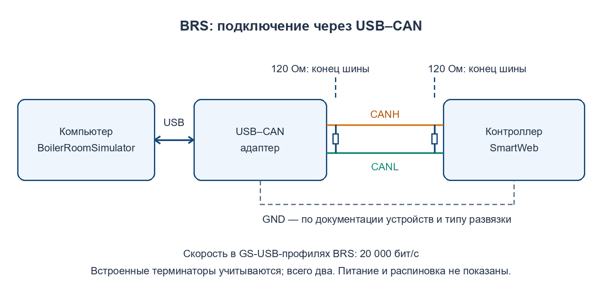
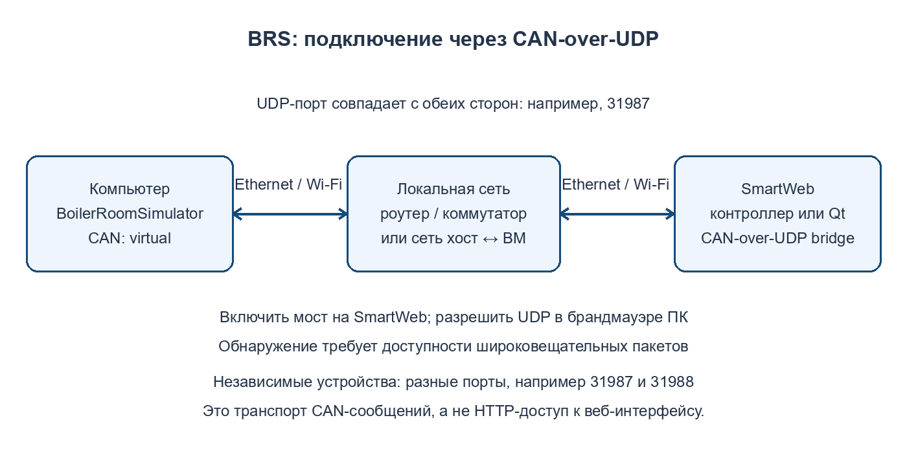
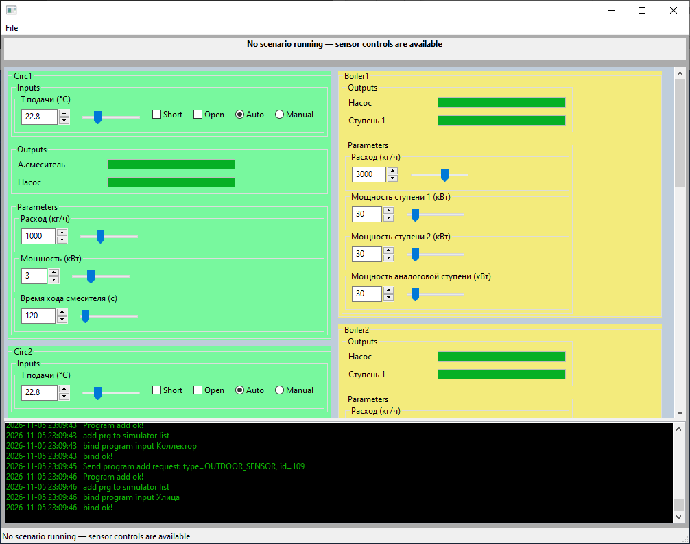
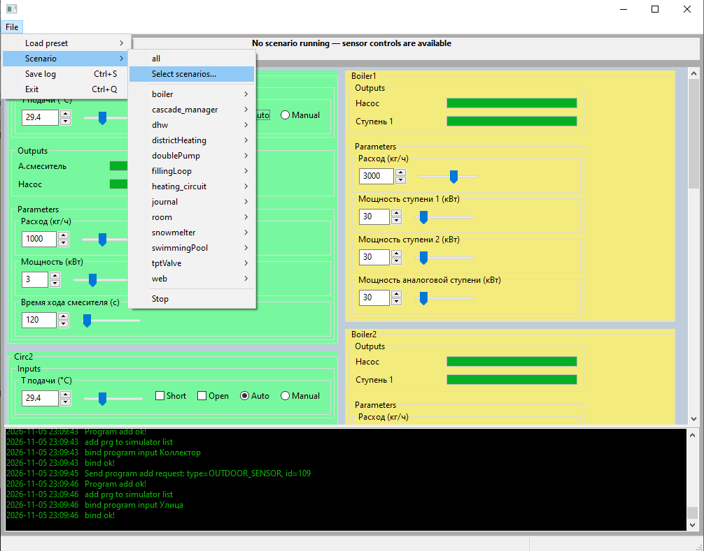
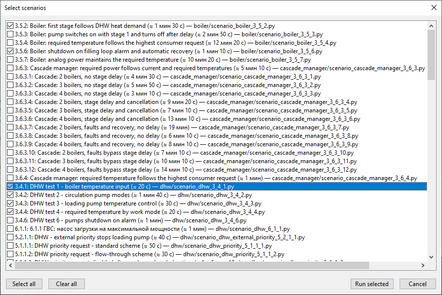
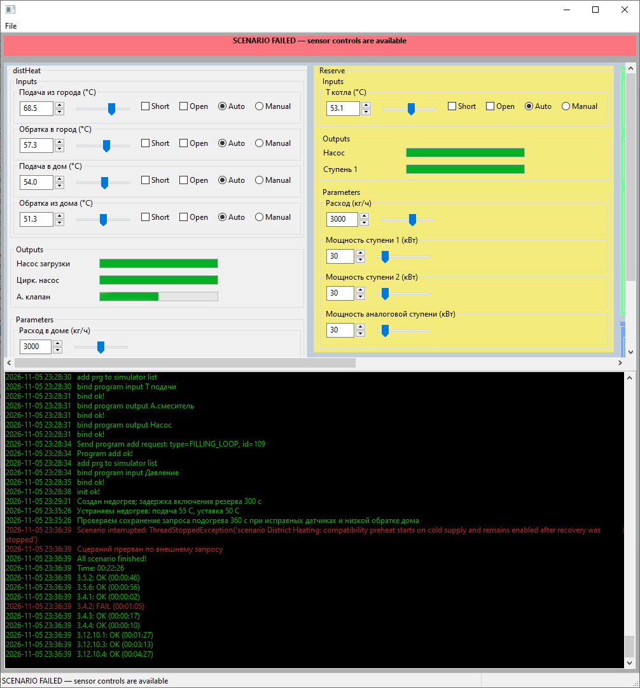
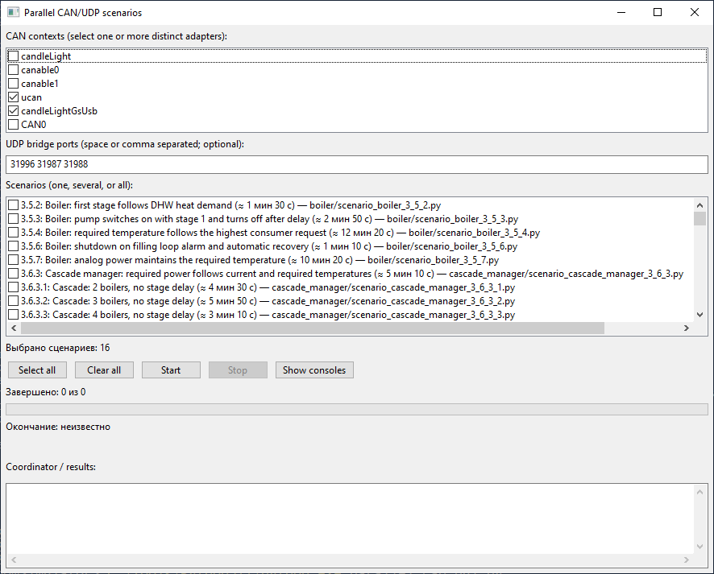
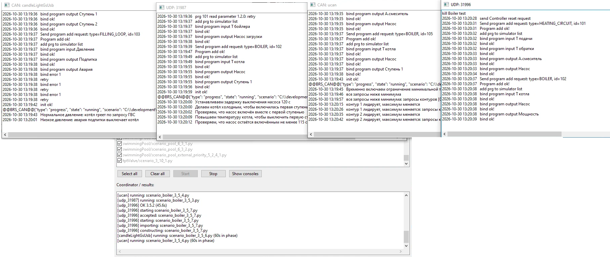
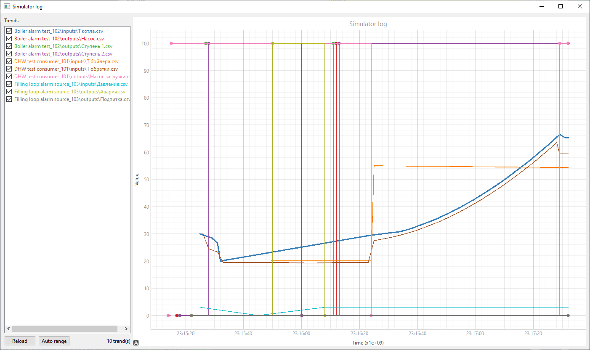

# BoilerRoomSimulator — руководство пользователя

Редакция от 5 ноября 2026 года

Работа с тестовым контроллером SmartWeb по CAN и CAN-over-UDP

Документ актуализирован по исходному BoilerRoomSimulator_Manual.odt и текущей реализации BRS. Снимки интерфейса предоставлены пользователем. Названия программ, состав сценариев и вид окон зависят от версии проекта и прошивки.

## 1. Назначение и принцип работы

BoilerRoomSimulator (BRS) — стендовая программа для проверки алгоритмов SmartWeb. Контроллер выполняет свою прошивку, а BRS моделирует её физическое окружение: датчики, насосы, нагрев и охлаждение. По протоколу SmartNet программа получает состояния выходов, передаёт показания виртуальных входов и читает или записывает параметры.

Например, при включении котла модель повышает температуру; отопительный контур отбирает тепло, а контроллер реагирует на изменившиеся показания. Автоматический сценарий задаёт условия проверки и наблюдает, выполнила ли прошивка ожидаемые действия.

- Тестируемый контроллер — реальное устройство или запущенный Qt-симулятор SmartWeb.
- Виртуальный контроллер ввода/вывода (VC) — эмулируемый BRS узел, к которому привязаны входы и выходы тестовых программ.
- Пресет — описание программ, привязок, настроек и виртуальных узлов для выбранной модели стенда.
- Сценарий — последовательность воздействий, ожиданий и проверок с checklist ID.

**Важно: BRS не прошивает контроллер и не заменяет проверку электрических цепей. Успешный сценарий подтверждает только условия, которые он действительно проверяет.**

**Используйте выделенный тестовый стенд. Загрузка пресетов может сбросить настройки и заменить программы контроллера. Восстановление ручных входов после сценария не означает восстановления исходной конфигурации устройства. Не подключайте рабочие исполнительные нагрузки к стенду без отдельной безопасной процедуры.**

## 2. Подготовка рабочего места

### 2.1. Программное обеспечение

Примеры рассчитаны на Windows, корень проекта C:\development\BoilerRoomSimulator и Python 3.11 по пути C:\Tools\Python311\python.exe. Если проект установлен иначе, замените путь к его каталогу. Команды выполняются в PowerShell.

Установите основные зависимости:

```powershell
Set-Location C:\development\BoilerRoomSimulator
C:\Tools\Python311\python.exe -m pip install -r requirements.txt
```

Главное окно BRS использует wxPython. Для отдельного просмотрщика графиков предусмотрен дополнительный набор зависимостей:

```powershell
Set-Location C:\development\BoilerRoomSimulator
C:\Tools\Python311\python.exe -m pip install -r requirements-graphs.txt
```

Режим --no-gui отключает главное окно, но не отменяет зависимости выбранного CAN-интерфейса. Панель стенда веб-привязок использует Tkinter, а не wxPython.

### 2.2. Перед подключением

1. Зафиксируйте модель контроллера и версию проверяемой прошивки.
2. Сохраните исходную конфигурацию средствами SmartWeb, если её потребуется восстановить.
3. Выберите способ подключения: USB–CAN или локальная сеть с CAN-over-UDP.
4. Убедитесь, что это нужное тестовое устройство, а не контроллер работающей установки.
5. Закройте другие приложения, использующие выбранный CAN-адаптер или UDP-порт.

## 3. Подключение по CAN

### 3.1. Физическое подключение



Соедините CANH адаптера с CANH контроллера, CANL — с CANL. Общий GND подключается согласно документации адаптера и контроллера; учитывайте наличие гальванической развязки. Схема показывает логические соединения, а не распиновку разъёмов и не цепи питания.

На каждом конце физической CAN-шины должен быть терминатор 120 Ом. Встроенный терминатор адаптера или контроллера считается одним из этих двух: не добавляйте третий. Ветвления и длинные ответвления нежелательны. В поставляемых GS-USB-профилях скорость равна **20 000 бит/с**; она должна совпадать со скоростью устройства.

### 3.2. Проверка адаптера

Для GS-USB нужен драйвер, совместимый с PyUSB. Если устройство не обнаруживается, проверьте драйвер; для соответствующего USB-устройства через Zadig применяют WinUSB или libusbK. Не меняйте драйверы посторонних устройств.

```powershell
Set-Location C:\development\BoilerRoomSimulator
C:\Tools\Python311\python.exe tools\list_gs_usb.py
```

Команда перечисляет адаптеры без отправки CAN-сообщений. В can.ini доступны:

- canable0 и canable1 — GS-USB-адаптеры с индексами 0 и 1. Порядок может измениться после переподключения.
- ucan — поиск по названию UCAN USB to CAN adapter.
- candleLightGsUsb — поиск по названию candleLight USB to CAN adapter; этот профиль тоже использует gs_usb.
- candleLight — отдельный старый профиль с интерфейсом candle; не путайте его с candleLightGsUsb.
- virtual — локальная виртуальная CAN-шина, а не физический USB-адаптер.

Если одинаковых адаптеров несколько, именованный профиль должен однозначно выбирать устройство; при необходимости задайте serial в can.ini. Ошибки неоднозначного выбора нельзя обходить запуском на случайном адаптере.

Перед сценариями можно проверить только связь:

```powershell
Set-Location C:\development\BoilerRoomSimulator
C:\Tools\Python311\python.exe tools\check_can_link.py --can ucan candleLightGsUsb
```

Укажите только реально подключённые профили. Утилита ожидает объявление контроллера и ответ на чтение списка программ, не загружая пресет. Успех подтверждает связь, но не правильность конфигурации сценария.

### 3.3. Запуск и выбор контроллера

```powershell
Set-Location C:\development\BoilerRoomSimulator
C:\Tools\Python311\python.exe main.py --can canable0 --id 0
```

GUI включён по умолчанию. При --id 0 BRS выбирает первый подходящий ответивший контроллер. Такой режим используйте только с одним тестируемым контроллером на шине. Если устройств несколько, задайте фактический ID (1–255), например:

```powershell
C:\Tools\Python311\python.exe main.py --can canable0 --id 37
```

Не путайте ID контроллера с ID его программ и именем CAN-профиля. Явное указание --can исключает зависимость от внешних настроек python-can; отсутствие этого аргумента не гарантирует выбор физического адаптера.

## 4. Подключение по UDP



### 4.1. Настройка сети

1. Подключите ПК и контроллер к локальной сети, в которой доступны широковещательные UDP-пакеты обнаружения.
2. На SmartWeb включите CAN-over-UDP bridge и проверьте номер порта.
3. Разрешите необходимый UDP-обмен в брандмауэре Windows для доверенной сети. Не отключайте брандмауэр целиком.
4. Запустите BRS с тем же портом. Для чистого UDP-подключения используйте локальный профиль virtual.

```powershell
Set-Location C:\development\BoilerRoomSimulator
C:\Tools\Python311\python.exe main.py --can virtual --udp 31987 --id 0
```

Без --udp мост отключён; --udp без числа включает порт 31987. Для другого порта задайте число явно, например --udp 31988, и измените настройку на контроллере. Возможность выбора порта зависит от прошивки.

### 4.2. Qt-симулятор SmartWeb

Qt-симулятор является отдельным приложением SmartWeb; BRS не запускает и не собирает его автоматически. Выберите проект с необходимой сетевой поддержкой, включите мост и обеспечьте доступность сетевого интерфейса. При использовании виртуальной машины настройте сеть между хостом и гостем, например host-only интерфейс; одного доступа к Интернету недостаточно для broadcast-обнаружения.

### 4.3. Ограничения UDP

Внутри BRS UDP-пакеты переводятся в CAN-сообщения и обратно. Это CAN-over-UDP, а не HTTP-подключение к веб-интерфейсу. Веб-адрес контроллера не выбирает UDP-сегмент.

Для независимых параллельных устройств задавайте разные порты, например 31987 и 31988. На каждом сегменте исключите чужие устройства и совпадающие ID. Не запускайте два приложения на одном UDP-порту. Доступность веб-интерфейса сама по себе не доказывает работоспособность CAN-over-UDP.

## 5. Главное окно и ручная проверка



После запуска BRS открывает транспорт, ожидает контроллер, читает его программы и подготавливает модели и сценарии. Сверьте найденный ID и набор программ с ожидаемым стендом. В журнале видны сообщения подключения, загрузки конфигурации и ошибок.

При несоответствии стартовому пресету не считайте устройство готовым к ручной симуляции. Проверьте конфигурацию и выберите подходящий пресет либо заранее выбранный сценарий. Сценарий может загрузить собственный пресет.

### 5.1. Пресеты

Ручной выбор: **File → Load preset → имя пресета**. Стартовый выбор можно задать аргументом --preset. Пресет описывает состав и привязки программ; загрузка может сбросить конфигурацию контроллера. Сначала остановите текущий сценарий и сохраните нужные результаты.

Выбор профиля --profile относится к локальным настройкам BRS в settings.ini, а не к прошивке. По умолчанию используется профиль main. В профиль сохраняются, в частности, выбранный пресет и список сценариев. Не переносите settings.ini на чужой стенд, не проверив эти настройки.

### 5.2. Датчики и параметры

Вне выполняющегося сценария доступные элементы GUI позволяют перевести входы в ручной режим и задавать значения. Отдельные поля управляют параметрами программы контроллера; это не то же самое, что моделируемый датчик.

1. Выберите нужную программу и вход по его названию.
2. Запомните исходное значение и ручной/автоматический режим.
3. Задайте тестовое значение и наблюдайте состояние выходов и журнал.
4. После проверки верните вход в автоматический режим, восстановите изменённые параметры.

Температурные модели — упрощение установки, а не теплотехнический расчёт реального объекта. BRS не может подменять показания произвольного физического датчика контроллера: для моделируемых входов нужны соответствующие виртуальные привязки.

**Во время сценария не вмешивайтесь вручную в датчики и параметры. Элементы управления входами блокируются, чтобы ручное воздействие не исказило проверку.**

## 6. Автоматические сценарии

### 6.1. Один сценарий

Сначала выберите один тест с известным назначением, а не весь каталог. Сценарии расположены в scenario/list/ и сгруппированы в меню.



Откройте **File → Scenario → нужная группа → сценарий**. Checklist ID связывает результат с пунктом проверки. Примерная длительность в подписи — ориентир, не общий тайм-аут.

Перед проверкой сценарий определяет необходимые программы и пресет. Некоторые сценарии принудительно загружают конфигурацию даже при похожем текущем наборе программ. Выбор теста даёт ему право изменять стенд в рамках его реализации.

### 6.2. Несколько сценариев

Откройте **File → Scenario → Select scenarios...**, отметьте нужные проверки и нажмите **Run selected**. **Select all** отмечает весь список, **Clear all** снимает отметки. Выбор сохраняется для текущего профиля settings.ini.



В одном сеансе выбранные сценарии выполняются последовательно и относятся к одному контроллеру. **File → Scenario → all** запускает всю обнаруженную коллекцию; это не безопасная универсальная проверка любой конфигурации. В каталоге могут находиться специализированные тесты с дополнительными требованиями, включая веб-стенд.

### 6.3. Состояния и результаты

- SCENARIO PREPARING — подготовка программ и пресета.
- SCENARIO RUNNING — выполнение проверки; ручные входы недоступны.
- SCENARIO FINISHED — последовательность завершена; результаты смотрите в журнале.
- SCENARIO FAILED — ошибка запуска или выполнения.
- SCENARIO STOPPED — остановка пользователем.

SCENARIO FINISHED само по себе не означает, что все тесты прошли. Для каждого checklist ID проверьте итог OK или FAIL и причины ошибки. У некоторых сценариев несколько результатов по отдельным пунктам чек-листа.



### 6.4. Остановка

Выберите **File → Scenario → Stop** и дождитесь очистки. Сценарии должны восстановить изменённые ручные входы, параметры и аварийные сигналы; после ошибки проверьте это по журналу и состоянию стенда. Не считайте незавершённую проверку успешной.

Для завершения BRS используйте **File → Exit**, закрытие окна или Ctrl+C в терминале. Не отключайте CAN-адаптер во время остановки. Принудительное завершение процесса или потеря питания не гарантируют восстановления.

## 7. Параллельное тестирование

### 7.1. Отдельная панель запуска

```powershell
Set-Location C:\development\BoilerRoomSimulator
C:\Tools\Python311\python.exe parallel_can_gui.py
```



1. Выберите CAN-профили разных физических адаптеров и/или введите разные UDP-порты.
2. Проверьте, что на каждом подключении доступно одно нужное устройство, а тесты совместимы с каждым выбранным контроллером.
3. Отметьте сценарии и нажмите **Start**.
4. Наблюдайте общий прогресс и отдельные журналы устройств. **Show consoles** повторно открывает окна журналов.
5. После завершения сохраните каталог запуска. Для отмены используйте **Stop** и дождитесь завершения очистки.



Панель запускает изолированный процесс на каждое подключение. Освободившийся контроллер получает следующий сценарий; каждый выбранный тест выполняется один раз, а не на каждом устройстве. При двух устройствах одновременно выполняются не более двух сценариев.

Проверка, уже начатая на отказавшем устройстве, автоматически не повторяется на другом. Невыполненные тесты отражаются отдельно. Чтобы прогнать весь набор на каждой версии прошивки, организуйте отдельные запуски, а не один общий пул.

### 7.2. Статусы и файлы

- OK — успешная проверка.
- FAIL — отрицательный результат сценария.
- ERROR — ошибка исполнения или устройства.
- INTERRUPTED — прерванная проверка.
- NOT_RUN — проверка не была выполнена.

Итоги находятся в **log/parallel_can_*/results.json**. В каталоге запуска для каждого worker сохраняются console.txt, собственные настройки и логи. Точный путь выводится в общем журнале. Время окончания ориентировочное и может сдвигаться.

Выбор панели сохраняется в parallel_can_settings.json. Не используйте выбранные адаптеры или порты одновременно в другом экземпляре BRS. Одинаковые UDP-порты и CAN-профили, указывающие на один физический адаптер, недопустимы.

### 7.3. Командная строка

Пример двух выбранных сценариев на двух CAN-адаптерах:

```powershell
Set-Location C:\development\BoilerRoomSimulator
C:\Tools\Python311\python.exe main.py --no-gui --can-ports ucan candleLightGsUsb --scenarios scenario\list\boiler\scenario_boiler_3_5_2.py scenario\list\boiler\scenario_boiler_3_5_3.py
```

Эти сценарии загружают свой пресет и меняют конфигурацию назначенных устройств. Для UDP замените --can-ports ucan candleLightGsUsb на --udp-ports 31987 31988, настроив соответствующие порты на стенде. Допускается сочетание физических CAN-подключений и разных UDP-портов.

Параллельный режим требует --no-gui. --scenarios применяется только с --can-ports или --udp-ports и не совмещается с --scenario. Общий --id применяется ко всем подключениям; при разных ID используйте отдельные одиночные сеансы. Код возврата параллельного запуска: 0 — все проверки OK, 2 — иной результат. Не переносите это правило на результат каждого сценария одиночного режима: там проверяйте журнал.

## 8. Журналы, графики и отчёт

### 8.1. Сохранение

В главном окне используйте **File → Save log** или Ctrl+S: сохраняются журналы программ и консольный журнал. При ошибке сценария также сохраняются связанные с проверкой логи. Для одиночного сеанса ищите файлы в log/; для параллельного — внутри каталога соответствующего запуска и worker.

Сохраняйте весь относящийся к запуску каталог, а не только картинку графика. Данные CSV нужны для повторного анализа. Не удаляйте предыдущие логи до оформления отчёта.

### 8.2. Просмотр графиков

```powershell
Set-Location C:\development\BoilerRoomSimulator
C:\Tools\Python311\python.exe show_graphs.py
```



Просмотрщик рекурсивно читает CSV из log/ относительно текущего каталога. **Reload** перечитывает данные, **Auto range** подбирает диапазон, отметки списка управляют видимостью трендов. Выберите тренд для выделения и скройте посторонние серии, чтобы сравнивать нужную температуру и выход.

Релейные значения в просмотрщике нормируются в проценты: 0 соответствует 0%, 255 — 100%. Общая ось Value может содержать разные физические величины; не трактуйте линию реле как температуру. Проверяйте имя серии, единицы и интервал времени. CSV нескольких старых запусков могут отображаться вместе.

### 8.3. Что включать в отчёт

- Дата, тестировщик, модель и ID устройства, версия прошивки и версия/ревизия BRS.
- Способ связи, CAN-профиль или UDP-порт, конфигурация стенда.
- Checklist ID и название каждой проверки, результат и длительность.
- Причина FAIL/ERROR, факт отмены или потери связи.
- Каталог исходных логов, results.json при параллельном запуске, поясняющие графики.
- Состояние контроллера после проверки и факт восстановления конфигурации.

Скриншот с зелёным сообщением не заменяет результаты всех пунктов. NOT_RUN и INTERRUPTED не являются успешными проверками; укажите их в отчёте явно.

## 9. Краткая справка по запуску

Получить текущую справку без запуска стенда:

```powershell
Set-Location C:\development\BoilerRoomSimulator
C:\Tools\Python311\python.exe main.py --help
```

Основные аргументы:

- --can имя — профиль CAN из can.ini. --can без значения выбирает default; default в поставляемом файле является virtual.
- --id число — ID тестируемого контроллера; 0 означает отсутствие фильтра выбора.
- --udp [порт] — включение CAN-over-UDP; без числа 31987, без аргумента мост выключен.
- --profile имя — локальный профиль settings.ini, по умолчанию main.
- --preset имя — стартовый пресет; используйте только проверенное имя из presets/list/ без расширения .py.
- --no-gui — без главного окна. --gui сохранён для совместимости, GUI уже включён по умолчанию.
- --scenario путь — запуск одного файла; --scenario без значения или --scenario all — вся коллекция.
- --can-ports имена и --udp-ports порты — подключения параллельного режима.
- --scenarios пути — выбранные файлы для параллельного режима.
- --console — сохранение консольного окна при использовании Windows-скрипта запуска.
- --debug — внутренний ответчик для разработки BRS; **не включайте на стенде с реальным контроллером**. Это не полная эмуляция алгоритмов SmartWeb.

Пример одиночного выбранного сценария без GUI:

```powershell
Set-Location C:\development\BoilerRoomSimulator
C:\Tools\Python311\python.exe main.py --no-gui --can canable0 --id 0 --scenario scenario\list\boiler\scenario_boiler_3_5_2.py
```

После завершения одиночной проверки приложение может оставаться запущенным; остановите его штатно. Оценка длительности в меню включает условное время подготовки пресета, но не является гарантией завершения к указанному моменту.

## 10. Веб-проверки и специальные режимы

BRS содержит проверки встроенного HTTP-интерфейса и отдельную панель выделенного стенда привязок:

```powershell
Set-Location C:\development\BoilerRoomSimulator
C:\Tools\Python311\python.exe web_bindings_gui.py
```

Это не обычная проверка моделируемой котельной. Стенд требует явных ID основного и вспомогательного контроллеров и их расширений, HTTP-доступа и изолированной разводки. Панель умеет проверять доступность, показывать схему и запускать только реализованные веб-сценарии.

**Запуск проверок привязок удаляет исходные программы тестируемого контроллера пресетом web_bindings; автоматического восстановления нет. Настройки панели содержат логин и пароль открытым текстом — не включайте их в скриншоты и отчёты.**

Аргументы --web-url, --web-login, --web-password-env и --web-timeout настраивают HTTP-сеанс. --web-url требует явный --id 1–255, не допускает --debug и параллельный запуск. В режиме --web-bench нужен --no-gui; запуск разрешённого сценария требует --confirm-web-bench. Режим all и стартовый пресет в этом режиме запрещены.

Подробные требования и границы покрытия приведены в [инструкции стенда веб-привязок](web_binding_bench_gui.md) и [описании веб-проверок](web_binding_tests.md). Не запускайте специальные сценарии на обычном стенде без выполнения их требований.

## 11. Диагностика и контрольный список

### 11.1. Контроллер не найден

Проверьте питание, CANH/CANL, терминацию, скорость, профиль адаптера и отсутствие конкурирующей программы. Повторите list_gs_usb.py. Для UDP проверьте мост, совпадение портов, broadcast-доступность и брандмауэр. Если задан --id, сверяйте его с фактическим ID устройства.

### 11.2. Найдено не то устройство

Остановите BRS до загрузки пресета. Изолируйте сегмент и задайте точный --id. Не продолжайте тест, надеясь, что сценарий сам выберет нужный контроллер.

### 11.3. Пресет не совпадает или не загружается

Проверьте соответствие модели устройства, поддерживаемых типов программ и выбранного пресета. Сообщение startup preset did not match в параллельном журнале не означает обрыв связи, но конфигурация требует проверки. Ошибки создания программ, записи параметров или привязок нельзя считать успешной подготовкой.

### 11.4. Сценарий долго подготавливается или завершился ошибкой

Смотрите сообщения подготовки, состояние устройства и ответы CAN/HTTP. В параллельном режиме подтверждение команды, импорт, создание сценария и исполнение отображаются отдельно. Текущий running не всегда означает, что закончилась вся подготовка. Сохраните журнал с первого сообщения ошибки. Не запускайте второй сценарий в том же одиночном сеансе до остановки первого.

### 11.5. Графики пусты

Сначала выполните Save log. Запускайте show_graphs.py из корня проекта, проверьте наличие CSV с несколькими точками и установку requirements-graphs.txt. Нажмите Reload. Просмотрщик не подключается к контроллеру напрямую и не заменяет сохранение данных.

### 11.6. Контрольный список

- До запуска: выбран выделенный стенд, сохранена конфигурация, проверены ID, проводка/сеть, профиль и отсутствие конфликтов.
- Во время: найден нужный контроллер, подготовка завершилась, ручные входы не изменяются посторонним вмешательством.
- После: проверены результаты всех пунктов, сохранены логи, выполнена штатная остановка, проверено безопасное состояние и восстановление необходимых настроек.

## 12. Пресеты, сценарии и структура проекта

Этот раздел предназначен для сопровождающего стенд. Для обычного прогона достаточно предыдущих разделов; менять код перед каждым тестом не требуется.

### 12.1. Основные компоненты

- main.py — аргументы и выбор одиночного/параллельного запуска.
- application.py — владение службами приложения, запуск и штатное завершение.
- mainThread.py — поиск контроллера, загрузка пресета, инициализация симулятора и сценариев.
- controllers/ — управление тестируемым устройством, обнаружение и виртуальный ввод/вывод.
- programs/ — модели программ, каналы и параметры; programs/factory.py — создание по типу.
- simulator/ — модели физического окружения; simulator/simulator.py — сопоставление типов и выполнение.
- smartnet/ — протокол CAN, параметры и каналы; udp/ — CAN-over-UDP.
- presets/ — привязки и конфигурации; presets/list/ — доступные пресеты.
- scenario/ — выполнение проверок; scenario/list/ — обнаруживаемые сценарии; scenario/base/ и scenario/steps.py — общая логика.
- gui/ — интерфейсы; parallel_can.py — распределение тестов между процессами.
- functions/ — общие помощники и журналы; tests/ и tools/ — проверки и утилиты.
- config_parser/ и main_config_parser.py — GUI преобразования файла конфигуратора в описание пресета.
- log/ — результаты; docs/ — инструкции по отдельным режимам.

### 12.2. Актуальный формат пресета

Файл пресета в presets/list/ предоставляет **get_presets_list()**, возвращающий описания программ и виртуальных контроллеров. В старом документе указаны прежние имена API; новый код должен следовать текущим соседним пресетам.

ProgramPreset описывает programType, programScheme, programId, programTitle, programSettings, programInputs, programOutputs и необязательный execution. Параметра power в текущем конструкторе нет. Протокольные типы, схемы, ID и индексы нельзя произвольно менять. Привязки и настройки удобно брать из presets/mapping.py и presets/settings.py.

ControllerPreset описывает controllerType, controllerId и controllerTitle. Для моделируемых входов используйте виртуальные узлы с уникальными ID; привязка к физическому датчику не даёт BRS возможности менять его показания. Эмуляция виртуального ввода/вывода не означает, что узел умеет выполнять произвольные программы контроллера.

execution='real' означает выполнение программы прошивкой. execution='virtual' — локальный протокольный источник; сейчас поддержан только OUTDOOR_SENSOR. При сценарной загрузке обычная улица, как правило, заменяется виртуальной; исключение journal_outdoor. Такой источник живёт только во время сценария и не добавляется в постоянный список программ устройства/GUI. Не допускайте конкурирующих источников улицы и совпадающих ID. Подробности: [виртуальные программы](virtual_programs.md).

### 12.3. Добавление сценария

Новый модуль должен иметь имя с checklist ID, класс Scenario на основе scenario.scenario.Scenario или подходящего общего базового класса и методы **get_scenario_title(), get_scenario_description(), get_checklist_id(), get_required_programs(), get_default_preset(), run()**.

Перед написанием изучите соседний сценарий, модель программы, выбранный пресет и поведение прошивки/симулятора. Используйте точные имена и ID, именованные интервалы ожидания и общие помощники. Обрабатывайте None при чтении/записи параметров; результат завершённого теста должен быть OK или FAIL. Изменённые параметры, ручные входы и аварийные сигналы восстанавливайте в finally, в том числе при отмене. Для оценки времени обновляйте scenario/metadata.py.

После изменения сценария выполните статическую проверку:

```powershell
Set-Location C:\development\BoilerRoomSimulator
C:\Tools\Python311\python.exe tools\validate_scenarios.py
```

Она не требует контроллера и не доказывает корректность реакции прошивки. Аппаратный или интеграционный прогон выполняется отдельно на подходящем стенде.

## 13. Источники и обновление документа

Дополнительные материалы:

- [Инструкция тестировщика](tester_guide.md).
- [GS-USB на Windows](canable_windows.md).
- [Параллельная панель CAN/UDP](parallel_can_gui.md).
- [Стенд веб-привязок](web_binding_bench_gui.md).
- [Виртуальные программы](virtual_programs.md).
- [Жизненный цикл приложения](application_lifecycle.md).

Редактируемый источник — docs/user_manual.md, изображения — docs/images/. Для повторного экспорта и изменения схем см. [инструкцию подготовки документов](manual_build.md). ODT и PDF создаются отдельно от старого BoilerRoomSimulator_Manual.odt. Если изменять только экспортированный ODT, повторная сборка не сохранит эти ручные изменения.

Команды и процедуры в этом руководстве сверены с кодом, но подготовка документа не является аппаратным испытанием стенда. Перед реальной проверкой повторите контрольный список и изучите требования выбранных сценариев.